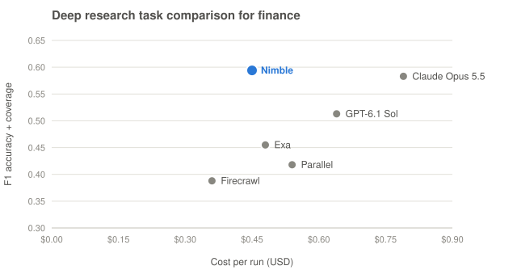

# Nimble for Company Investment Research

Agent skills that give your AI agent (Claude, ChatGPT, Cursor, Codex and others) the live web as cited, structured data for hedge fund company research, powered by [Nimble](https://www.nimbleway.com).

| Skill | What it does |
| - | - |
| [`onboard-your-agent`](skills/onboard-your-agent/SKILL.md) | Start here. Shows the finance benchmark chart (deep research task comparison for finance) and the four use cases as tiles for testing Nimble's APIs in your AI plus a tile for integrating them into your stack, gets you onto a free Nimble trial and connected, then routes your research request. |
| [`company-deep-research`](skills/company-deep-research/SKILL.md) | Cited deep research with 13 hedge fund Web Search Agents (fundamental deep dive, catalyst calendar, filing changes, forensic red flags, management track record, channel check, customer and supplier map, competitor momentum, government contracts, deal terms, deal tracker, credit file, credit early warning), plus a playbook for building your own agent when none fits. |
| [`company-fast-search`](skills/company-fast-search/SKILL.md) | Answers in seconds with Nimble Search, Extract and Extract Templates: query patterns, source priority, date scoping, entity disambiguation and MNPI-safe sourcing for any company question. |
| [`filings-media-pdfs`](skills/filings-media-pdfs/SKILL.md) | Parse 10-K exhibits, decks, credit and merger agreements and spreadsheets into markdown with Extract file parsing; download PDFs, images, audio and video with the Media API, to disk or straight to S3/GCS. |
| [`alt-data-at-scale`](skills/alt-data-at-scale/SKILL.md) | Build alternative-data panels (prices, promotions, rankings, reviews, job postings, store footprints, social, AI-answer visibility) with Extract Templates: batch runs of up to 1,000 inputs, scheduled Extract Jobs into S3 or Databricks, and template generation for sites without one. |

## Quick start

1. **Get a free trial:** https://online.nimbleway.com/signup
2. **Install the skills.** One command for Claude Code, Codex, Cursor and other agents:

   ```bash
   npx skills add Nimbleway/nimble-for-company-investment-research
   ```

   Other ways to install:

   - **Claude Code, with the MCP server bundled (one step instead of two):** `claude plugin marketplace add Nimbleway/nimble-for-company-investment-research`, then `claude plugin install nimble-investment-research@nimble-investment-research`.
   - **ChatGPT (Business, Enterprise and Edu):** zip a folder under `skills/` and upload it under **Skills → Create → Upload from your computer**, one zip per skill. On other plans, add the `SKILL.md` files to a project or custom GPT's instructions.
   - **Claude.ai:** zip a folder under `skills/` and upload it under **Customize → Skills**.
   - **Any other agent:** add the `SKILL.md` files to its instructions.

3. **Say "onboard my agent for investment research"**, or try *"Underwrite Duolingo long on paid subscriber growth."* The onboarding skill checks whether Nimble is connected and, if not, walks you through it for your host. The Nimble MCP server (`https://mcp.nimbleway.com/mcp`) uses OAuth, so no API key is needed:

   | Host | Connect Nimble |
   | - | - |
   | Claude Code | `claude mcp add --transport http --scope user nimble https://mcp.nimbleway.com/mcp`, then run `/mcp` and authorize **nimble** (already bundled if you installed the plugin) |
   | ChatGPT | Settings → Apps & Connectors → add a custom connector with URL `https://mcp.nimbleway.com/mcp` (developer mode on some plans) |
   | Claude.ai / Claude Desktop | **Customize → Connectors** → add a custom connector at `https://mcp.nimbleway.com/mcp` |
   | Codex, Cursor and other MCP clients | Add the server URL above to the client's MCP config; the first tool call starts OAuth |

   For PDF parsing, media downloads, batches and Jobs, also install the CLI (`npm i -g @nimble-way/nimble-cli`) and set `NIMBLE_API_KEY` from https://online.nimbleway.com/settings/api-keys.

   To call the same APIs from your own code, agents or warehouse, see https://docs.nimbleway.com/integrations/overview.

## Example requests

- "Underwrite Duolingo long on paid subscriber growth."
- "Build a catalyst calendar for Viking Therapeutics (VKTX) for the next 12 months."
- "What changed in Boeing's latest 10-K risk factors versus the prior year?"
- "Track the approval status of Union Pacific's acquisition of Norfolk Southern."
- "Log early-warning signals for New Fortress Energy since 2026-05-01."
- "Who is CoreWeave's CFO, and when did they join?" (fast search)
- "Pull the maturity schedule out of this credit agreement PDF." (filings and PDFs)
- "Track Celsius and Alani Nu prices and in-stock rates at Walmart and Target daily for 20 zip codes." (alt data)

## Principles every skill follows

- **Public information only.** No paywalled, logged-in, leaked or expert-network content, so no MNPI risk from the data.
- **Primary sources first.** Filings, regulators, courts and company statements are cited over press and aggregators.
- **Every value is sourced and dated.** If nobody published a value, it is reported as not found, not estimated.
- **Point in time.** Values carry the date they were published, so you can tell what the market knew and when.

## Benchmark

<picture>
  <source media="(prefers-color-scheme: dark)" srcset="skills/onboard-your-agent/assets/benchmark-chart-dark.svg">
  
</picture>

*Finance Use-Case Benchmark v2, 40 tasks, November 2026. Higher and further left is better.*

In Nimble's public Finance Use-Case Benchmark v2 (40 tasks, six providers, November 2026), Nimble had the highest combined score across the eight finance jobs (0.594, Claude Opus 5.5 0.583) at $0.45 a run. On hedge fund company research it returned the most verified facts and got every critical answer-key question right, while Claude Opus 5.5 scored higher overall (0.608 against 0.573). Tables, method and caveats: [`benchmark/README.md`](benchmark/README.md).

## Layout

```
skills/
  onboard-your-agent/SKILL.md
  onboard-your-agent/assets/                  # prebuilt benchmark chart + tiles (inline fragment, page, PNG, SVGs) and build.py
  onboard-your-agent/assets/                  # prebuilt onboarding screen (SVG chart, HTML, PNG) + build.py
  company-deep-research/SKILL.md
  company-deep-research/agents/hf-*.json      # 13 agent specs: skill, output schema, example questions
  company-fast-search/SKILL.md
  company-fast-search/references/source-map.md
  filings-media-pdfs/SKILL.md
  alt-data-at-scale/SKILL.md
  alt-data-at-scale/references/template-catalog.md
benchmark/README.md                           # Finance Use-Case Benchmark v2 results
.claude-plugin/                               # Claude Code plugin + marketplace manifests
.mcp.json                                     # Nimble MCP server, bundled with the Claude Code plugin
```

## Docs

- Nimble docs: https://docs.nimbleway.com (machine index: https://docs.nimbleway.com/llms.txt)
- Web Search Agents: https://docs.nimbleway.com/nimble-sdk/web-search-agents/overview
- Extract Templates: https://docs.nimbleway.com/nimble-sdk/web-tools/extract/template
- Media: https://docs.nimbleway.com/nimble-sdk/web-tools/media
- File parsing: https://docs.nimbleway.com/nimble-sdk/web-tools/extract/features/file-parsing

These skills help with research workflows; they are not investment advice.

## License

MIT
